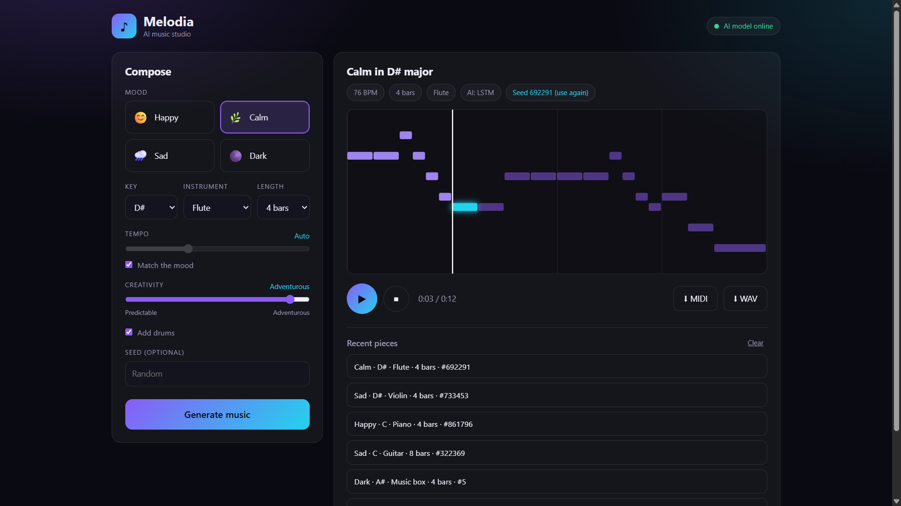

# Melodia: AI Music Generator

Melodia composes original music with a neural network. Pick a mood, key and instrument, and it writes a complete piece with melody, chords and bass (and drums, if you want them). You can play it in the browser or download it as MIDI or WAV.




*Built for the CodeAlpha AI internship, Task 3: Music Generation with AI.*

## Live demo: 
 https://melodia-ai-s1ww.onrender.com
 
*(The free server sleeps when idle, so the first load can take up to a minute.)*

## Video demo: [Watch on Google Drive]
(https://drive.google.com/file/d/191WxEKU3kowR53-4g2k0SJYeBObQPlBZ/view?usp=sharing)

## Features
- **LSTM neural network** trained on about 1,000 folk-tune MIDI files, with a mood setting (major or minor)
- **Composer logic** on top of the AI: scale-aware sampling, smooth melodic motion, 2-bar phrases that repeat (A B A C), and proper cadences
- **Automatic arrangement:** chord progressions, voice-led chords and a bass line that change with the mood (oom-pah, arpeggio, pad, drive), plus optional drums
- **In-browser synthesizer** with reverb, no plugins needed: piano, music box, guitar, violin and flute
- **Downloads** as MIDI or WAV, **seeds** to recreate any piece exactly, and a history of recent pieces
- **Safe by design:** input validation, rate limiting, and a backup generator if the model is unavailable

## How it works
1. **Training** (`backend/train.py`): melodies are extracted from MIDI files, moved to C major or A minor, and turned into sequences of 16th-note steps. A 2-layer LSTM learns to predict the next step.
2. **Generation** (`backend/generator.py`): the model proposes notes, and music-theory rules steer it. Several candidates are scored and the most musical one is kept.
3. **Arrangement:** chords are chosen to fit the melody, then written as a playing pattern for the chosen mood.
4. **Playback** (`frontend/script.js`): a Web Audio synthesizer renders the piece live, and the same engine renders the WAV download.

## Run it locally
```bash
git clone https://github.com/omprashanth2425/CodeAlpha_MusicGenerationWithAI.git
cd CodeAlpha_MusicGenerationWithAI
python -m venv venv
venv\Scripts\activate          # Mac/Linux: source venv/bin/activate
pip install -r requirements.txt
cd backend
python app.py
```
Open http://127.0.0.1:8000. A trained model is included. To retrain it, run `python download_data.py` and then `python train.py`.

## API
| Method | Path | Description |
|---|---|---|
| GET | `/api/health` | Server status and whether the AI model is loaded |
| GET | `/api/options` | Available moods, keys and instruments |
| POST | `/api/generate` | Generate a piece (`mood`, `key`, `instrument`, `bars`, `tempo`, `temperature`, `seed`, `drums`) |

Interactive docs are available at `/docs`.

## Project structure
```
backend/   app.py (API), generator.py (composer), music_common.py, train.py, download_data.py, models/
frontend/  index.html, style.css, script.js (UI and synthesizer)
```

## Limitations
- The model is small and trained on folk tunes, so the style leans folk and traditional.
- Instrument sounds are synthesized, not recorded samples.

## Data and licensing
The training tunes come from the Nottingham Music Database. Check the dataset's license before using this project commercially.

## Author
 kotla Omprashanth Reddy
